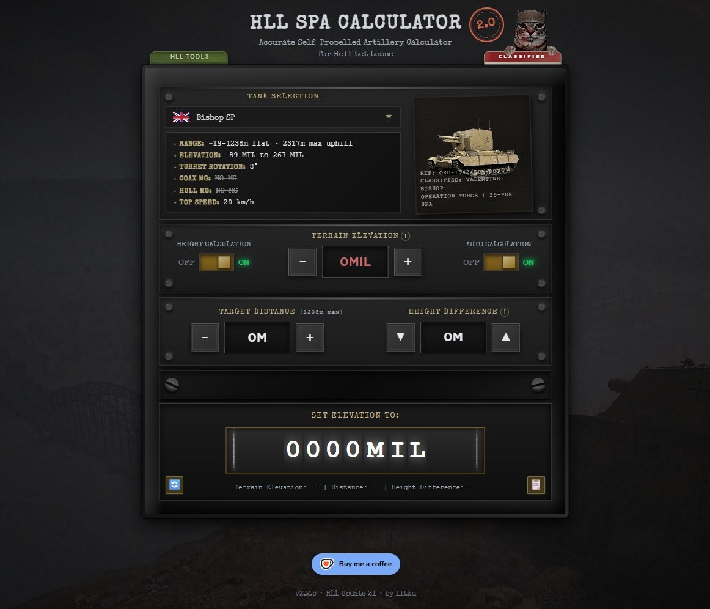
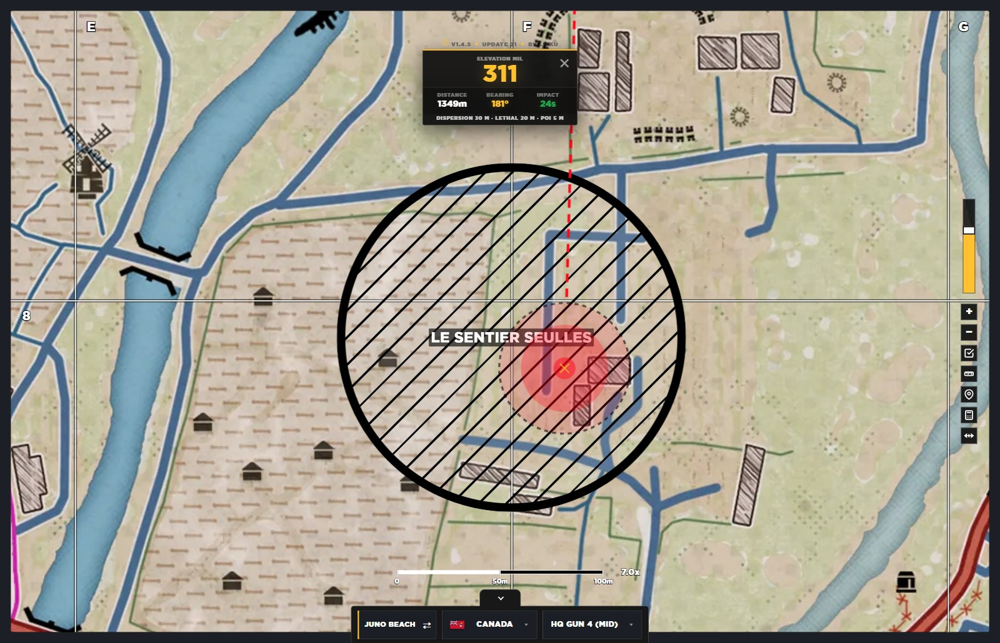
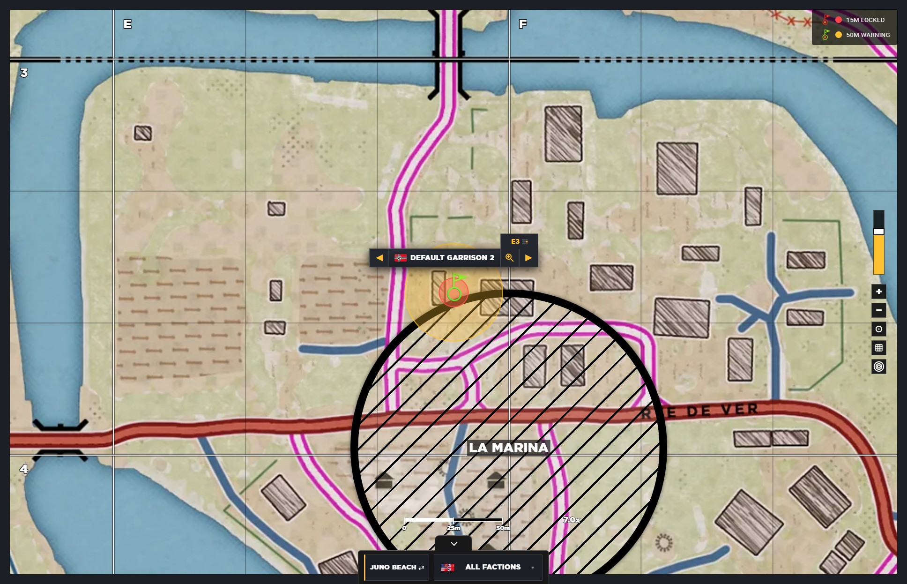



<h1>litku</h1>

Hello, stranger. I'm litku.

Dilettante web developer, 3D modeler and game modder. Small dose of autism, shit ton of coffee.

Projects below, or watch this cute lil bugger doing some munchies.

  
  
  

  
  
  
  
  

## Active project

  <h3>Project Tin Can</h3>
  
██████████ ████ ██████████. █ ████ ████ ███ ███ ███████.

  
File ██–███ · sealed until the next patch

## Released

### Hell Let Loose

#### [SPA Calculator](https://l1tku.github.io/hll-spa-calculator/) <a class="tag tag-primary" href="https://github.com/l1tku/hll-spa-calculator" target="_blank" rel="noopener noreferrer">github</a> web-app 

  

The one and only SPA calculator built on the ballistics the game uses right now, and
the most used of them all. You can't get more precise than this. Height calculation
included.

**[Open the calculator →](https://l1tku.github.io/hll-spa-calculator/)**

#### [Arty Map Calculator](https://l1tku.github.io/hll-arty-map-calculator/) <a class="tag tag-primary" href="https://github.com/l1tku/hll-arty-map-calculator" target="_blank" rel="noopener noreferrer">github</a> web-app 

  

The most precise artillery calculator out there. Gun positions, strongpoints, blast
zones, true 1:1. Manual calculator, ballistic rulers jada jada jada.

**[Open the map calculator →](https://l1tku.github.io/hll-arty-map-calculator/)**

#### [Default Garrisons](https://l1tku.github.io/hll-default-garrisons/) <a class="tag tag-primary" href="https://github.com/l1tku/hll-default-garrisons" target="_blank" rel="noopener noreferrer">github</a> web-app 

  

Every default garrison in Offensive mode, 1:1 with the game. Their safe space, mapped.

**[Open default garrisons →](https://l1tku.github.io/hll-default-garrisons/)**

## About

Small tools, made properly, for the games I actually play.

Got a question, a bug, or an idea? Open an issue on
[GitHub](https://github.com/l1tku) or message me on
[Discord](https://discord.com/users/232874292604305408).

If you love my tools and want to support me, you can do that here:
[Buy Me a Coffee](https://buymeacoffee.com/litku), [Ko-fi](https://ko-fi.com/litku) or
[GitHub Sponsors](https://github.com/sponsors/l1tku).

You read all of it. There's a grumpy hedgehog down there.
Be nice to it.

████ █████ ████████ ███ ████ ████ ███ ██ █████

  

&gt; humanity_test: passed &gt; humanity_faith: restored &gt; good_luck: +15 years, non-refundable &gt; recipient: you, stranger &gt; expires: {{expires}} &gt; end of transmission

